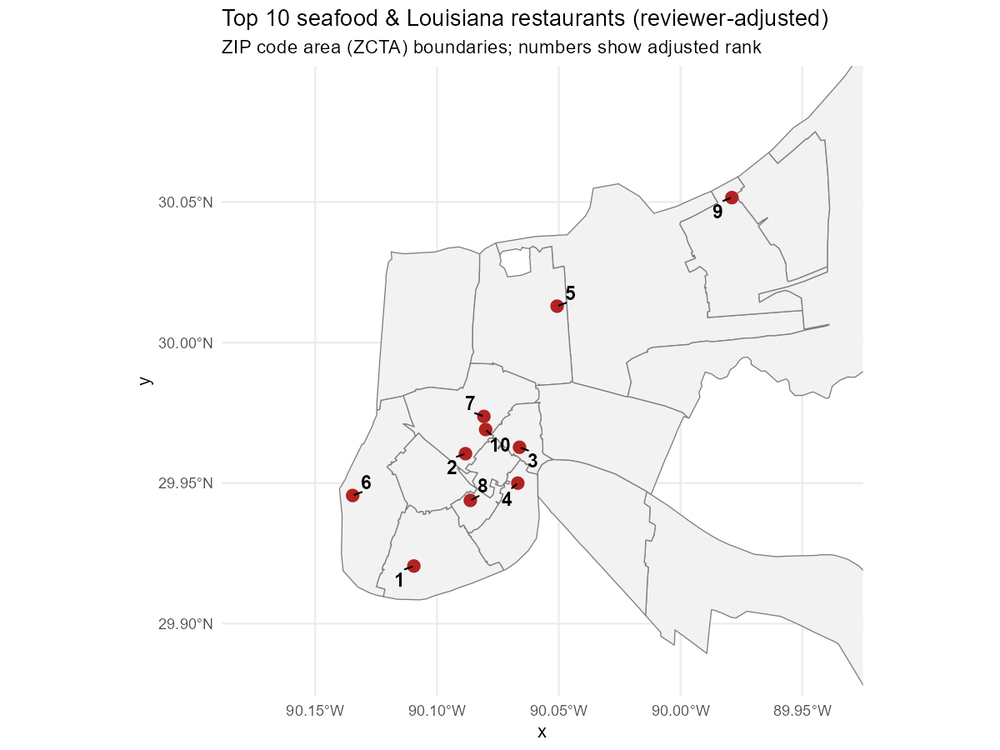

# Where to Find the Best Seafood and Louisiana Cooking in New Orleans

**Research question:** Where in New Orleans can someone find the best seafood
and Louisiana-style restaurants, and which ZIP code area is best for finding
them?

**[View the complete report](yelp_new_orleans_project.md)**

## Executive summary 

I analyzed 656 seafood and Louisiana-cooking restaurants inside the official
New Orleans boundary, using 249,002 Yelp reviews from 138,367 reviewers.
Because some reviewers rate everything highly and others rarely do, I ranked
restaurants by how much reviewers rated them above or below their own usual
scores, using only restaurants with at least 30 reviews from frequent
reviewers (345 of 656). I compared ZIP code areas with census tracts and chose
ZIP code areas, because tracts split the restaurants too finely to compare.

## Main findings

1. **The best-rated places are spread across the city.** The top 10 fall in
   eight ZIP code areas (70119 has three; the others have one each).
2. **The top 10 depends on how much evidence you require.** Restaurants with
   only a few reviews can reach the top on a handful of generous ratings, so I
   required at least 30 reviews from frequent reviewers.
3. **Adjusting for reviewer habits keeps the overall ordering but changes
   many individual ranks.** Raw average stars and the adjusted score are
   strongly correlated (r = 0.91), yet some restaurants move more than 100
   places.

The top 10, with their ZIP code areas and scores, are in the report. The
adjusted score is not a new Yelp rating: it measures whether reviewers rated a
restaurant higher or lower than they usually do.

## Data

The Yelp Open Dataset is several GB and is **not** stored in this repository,
because GitHub does not accept files this large. To reproduce the filtered data:

1. Download the Yelp Open Dataset (JSON) from
   <https://business.yelp.com/data/resources/open-dataset/>.
2. Extract it into `data/raw/` so that the files are at
   `data/raw/Yelp JSON/yelp_dataset/yelp_academic_dataset_business.json` and
   `.../yelp_academic_dataset_review.json`. (The download is a zip that
   contains a tar file, so it needs two extraction steps.)
3. Run `R/import.R`.

You do **not** need the raw files to re-render the report. It reads the
filtered files below, which are in this repository, and it downloads Census
boundaries with the `tigris` package, so it needs an internet connection.

## Files and folders

- `yelp_new_orleans_project.qmd`: source of the report
- `yelp_new_orleans_project.md`: the rendered report, readable on GitHub
- `R/import.R`: imports the raw JSON, filters to New Orleans restaurants, and
  saves the files below
- `data/new_orleans/business_new_orleans.rds`: 2,259 New Orleans restaurants
- `data/new_orleans/reviews_new_orleans_no_text.rds`: 476,421 reviews for
  those restaurants, with the review text removed to keep the file small
- `figures/`: maps and plots used in the report
- `ai_prompts.md`: record of the AI prompts I used

The full reviews file with text (`reviews_new_orleans.rds`, about 112 MB) is
over GitHub's 100 MB limit, so it is excluded with `.gitignore`.
`R/import.R` recreates it.

## Handling the large data

- **Download and extraction.** The download is a 4.3 GB zip containing a 4.3 GB
  tar file, which holds the JSON files. The review file is 5.3 GB and the user
  file 3.4 GB. I unzipped, then extracted the tar, which temporarily meant
  holding three copies of the same data, so I deleted the zip and tar once the
  JSON files were confirmed.
- **Cloud sync.** My project folder was inside OneDrive, which tried to upload
  the multi-gigabyte files and reported a sync error on the review file. I
  [paused syncing / moved the data / describe what you did].
- **Importing the 5.3 GB review file.** Loading it all at once risks running
  out of memory, so I first filtered the small business file to New Orleans
  restaurants (2,259), then read the review file in chunks of 50,000 reviews
  with `jsonlite::stream_in()` and a handler that kept only the reviews for
  those restaurants. It scanned 6,990,280 reviews and kept 476,421. [Add:
  roughly how long it took, and your computer's memory if relevant.]
- **Saving results.** The filtered files are saved as compressed `.rds` files.
  The reviews file with text was about 112 MB, over GitHub's 100 MB limit, so
  it stays on my computer and I committed a version without the text column
  (7.9 MB), which still has all 476,421 reviews. The review text is not used in
  the analysis.
- **Checks.** I confirmed every kept review belongs to one of the selected
  restaurants, that the saved files read back with the right number of rows,
  and that no columns had missing values. [Add whether you deleted the raw
  files afterward.]

## Reproducing the report

Install Quarto and these R packages: `tidyverse`, `jsonlite`, `sf`, `tigris`,
`ggrepel`, and `knitr`. Then run `quarto render yelp_new_orleans_project.qmd`.