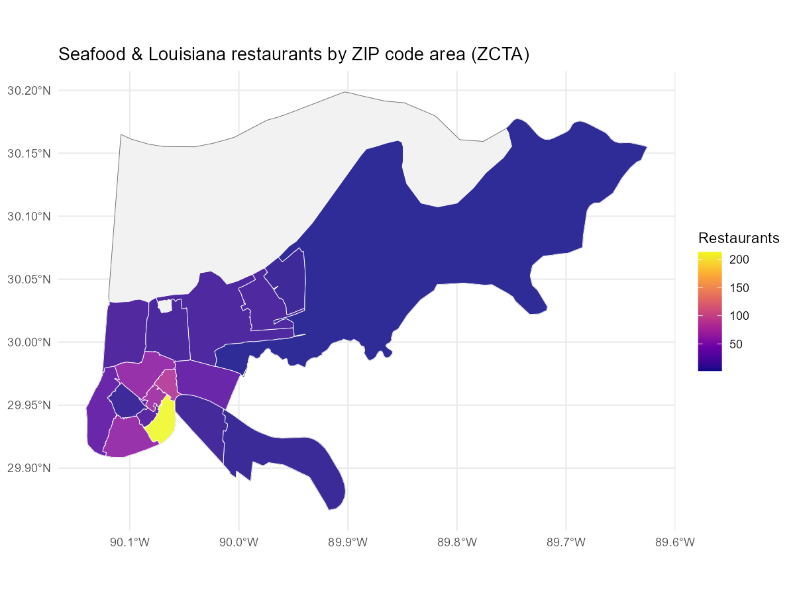
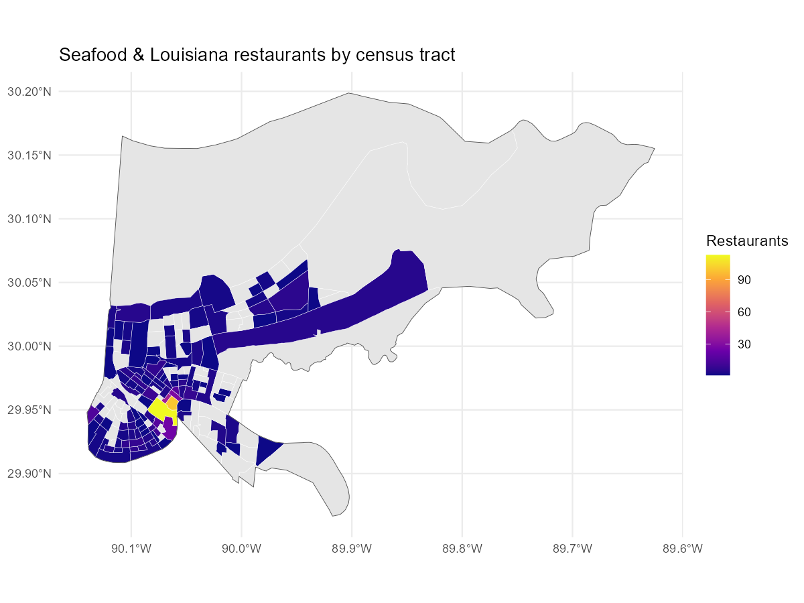

# Seafood and Louisiana Restaurants in New Orleans: Choosing a Geographic Area


``` r
library(tidyverse)
library(sf)
library(tigris)
options(tigris_use_cache = TRUE)
dir.create("figures", showWarnings = FALSE)
```

## Research question and area choice

**Question:** Where in New Orleans can someone find the best seafood and
Louisiana-style restaurants, and which geographic area is best for
comparing them?

**Area I am picking: ZIP code areas (ZCTAs).** I compared ZCTAs with
census tracts. ZCTAs divide the 656 New Orleans restaurants into 17
areas, and 12 of them have at least 10 restaurants and together hold
95.4% of the restaurants. Census tracts divide the same restaurants into
111 areas, but only 10 have at least 10 restaurants, and those hold just
57.3%. Half of the tracts (57 of 111) have only one or two restaurants,
so a tract’s average rating would mostly reflect one or two places. ZIP
codes are also familiar to a general audience.

## Data

The filtered data come from the Yelp Open Dataset (see README for how it
was built with `R/import.R`).

``` r
new_orleans_restaurants <- readRDS("data/new_orleans/business_new_orleans.rds")
reviews <- readRDS("data/new_orleans/reviews_new_orleans_no_text.rds")
nrow(new_orleans_restaurants)
```

    [1] 2259

``` r
nrow(reviews)
```

    [1] 476421

## Step 3: Category group

``` r
restaurant_categories <- new_orleans_restaurants |>
  select(business_id, categories) |>
  separate_longer_delim(categories, delim = ",") |>
  mutate(category = str_to_lower(str_squish(categories))) |>
  select(business_id, category)

selected_categories <- c("seafood", "cajun/creole", "southern", "soul food")

cand <- restaurant_categories |> filter(category %in% selected_categories)

cand |> count(category, sort = TRUE)
```

          category   n
    1 cajun/creole 401
    2      seafood 331
    3     southern 155
    4    soul food  70

``` r
n_distinct(cand$business_id)
```

    [1] 672

**Why these categories belong together:** Seafood, Cajun/Creole,
Southern, and Soul Food are all part of Louisiana cooking, and they
overlap in the data. The strongest link is between Cajun/Creole and
seafood: 156 restaurants carry both labels, which is 47% of the 331
seafood restaurants. Cajun/Creole also overlaps with Southern (72
restaurants) and Soul Food (30). Of the 672 restaurants in the group,
231 (34%) carry two or more of the four categories, and 3 carry all
four. Most restaurants (441) carry only one of them, so the group is
held together by a shared cuisine theme with partial overlap, not by
most restaurants carrying several labels.

Pairs of categories that appear together on the same restaurant:

``` r
cand |>
  inner_join(cand, by = "business_id", suffix = c("_a", "_b"),
             relationship = "many-to-many") |>
  filter(category_a < category_b) |>
  count(category_a, category_b, sort = TRUE)
```

        category_a category_b   n
    1 cajun/creole    seafood 156
    2 cajun/creole   southern  72
    3      seafood   southern  45
    4 cajun/creole  soul food  30
    5      seafood  soul food  20
    6    soul food   southern  19

**Inclusion rule:** a restaurant is included if it has at least one of
the four categories. I also considered “seafood markets” and “fish &
chips,” but together they add only 3 restaurants not already in the
group, so I left them out.

``` r
selected_restaurants <- new_orleans_restaurants |>
  semi_join(cand, by = "business_id")
nrow(selected_restaurants)
```

    [1] 672

## Step 4: Join reviews

``` r
category_reviews <- reviews |>
  semi_join(selected_restaurants, by = "business_id") |>
  rename(review_stars = stars) |>
  left_join(
    selected_restaurants |>
      select(business_id, business_name, business_stars = stars),
    by = "business_id"
  )
nrow(category_reviews)
```

    [1] 250304

``` r
n_distinct(category_reviews$business_id)
```

    [1] 672

## Step 5: Spatial join to the official New Orleans boundary

``` r
louisiana_places <- tigris::places(state = "LA", cb = TRUE, year = 2024, class = "sf")

restaurant_points <- selected_restaurants |>
  st_as_sf(coords = c("longitude", "latitude"), crs = 4326, remove = FALSE) |>
  st_transform(st_crs(louisiana_places))

restaurants_with_place <- restaurant_points |>
  st_join(louisiana_places |> select(GEOID, place_name = NAME),
          join = st_within, left = TRUE)

restaurants_with_place |>
  st_drop_geometry() |>
  count(city, place_name, sort = TRUE)
```

              city  place_name   n
    1  New Orleans New Orleans 656
    2  New Orleans     Harahan   4
    3  New Orleans   Jefferson   4
    4  New Orleans     Elmwood   2
    5  New Orleans       Arabi   1
    6  New Orleans      Gretna   1
    7  New Orleans      Harvey   1
    8  New Orleans      Kenner   1
    9  New Orleans    Metairie   1
    10 New Orleans River Ridge   1

Of the 672 selected restaurants, 656 fall inside the Census boundary for
New Orleans. The other 16 have a Yelp city of “New Orleans” but fall in
neighboring places: Harahan (4), Jefferson (4), Elmwood (2), and one
each in Arabi, Gretna, Harvey, Kenner, Metairie, and River Ridge. Most
have street addresses on roads such as Jefferson Highway, S Clearview
Parkway, and Westbank Expressway, which suggests Yelp’s city label is
broader than the official boundary. Two have blank addresses, and one of
them (Le Petit Bistro) has a ZIP code (70115) that does not match its
coordinates near Kenner, so its location is unreliable. I excluded all
16 because the question is about New Orleans.

``` r
new_orleans_map_data <- restaurants_with_place |>
  filter(place_name == "New Orleans")
nrow(new_orleans_map_data)
```

    [1] 656

## Step 6: Comparing geographic systems

``` r
zctas <- tigris::zctas(cb = TRUE, starts_with = c("70", "71"), year = 2020) |>
  select(zcta = starts_with("ZCTA5CE"))

pts_zcta <- new_orleans_map_data |>
  st_transform(st_crs(zctas)) |>
  st_join(zctas, join = st_within, left = TRUE)

zcta_summary <- pts_zcta |>
  st_drop_geometry() |>
  filter(!is.na(zcta)) |>
  group_by(zcta) |>
  summarise(n_restaurants = n(),
            avg_business_stars = round(mean(stars), 2),
            .groups = "drop") |>
  arrange(desc(n_restaurants))

tracts <- tigris::tracts(state = "LA", county = "Orleans", cb = TRUE,
                         year = 2020, class = "sf") |>
  select(tract = GEOID)

pts_tract <- new_orleans_map_data |>
  st_transform(st_crs(tracts)) |>
  st_join(tracts, join = st_within, left = TRUE)

tract_summary <- pts_tract |>
  st_drop_geometry() |>
  filter(!is.na(tract)) |>
  group_by(tract) |>
  summarise(n_restaurants = n(),
            avg_business_stars = round(mean(stars), 2),
            .groups = "drop") |>
  arrange(desc(n_restaurants))
```

### Comparison table

``` r
compare <- function(name, pts, id, summ) {
  tibble(
    `Geographic system` = name,
    `Areas with restaurants` = nrow(summ),
    `Restaurants assigned` = sum(summ$n_restaurants),
    `Unmatched` = sum(is.na(pts[[id]])),
    `Smallest count` = min(summ$n_restaurants),
    `Largest count` = max(summ$n_restaurants),
    `Areas with 10+` = sum(summ$n_restaurants >= 10),
    `Share of restaurants in areas with 10+` =
      round(sum(summ$n_restaurants[summ$n_restaurants >= 10]) /
              sum(summ$n_restaurants), 3)
  )
}

bind_rows(
  compare("ZIP/ZCTA", pts_zcta, "zcta", zcta_summary),
  compare("Census tract", pts_tract, "tract", tract_summary)
) |> knitr::kable()
```

| Geographic system | Areas with restaurants | Restaurants assigned | Unmatched | Smallest count | Largest count | Areas with 10+ | Share of restaurants in areas with 10+ |
|:---|---:|---:|---:|---:|---:|---:|---:|
| ZIP/ZCTA | 17 | 656 | 0 | 2 | 213 | 12 | 0.954 |
| Census tract | 111 | 656 | 0 | 1 | 113 | 10 | 0.573 |

### Restaurants and average rating by ZCTA

``` r
knitr::kable(zcta_summary)
```

| zcta  | n_restaurants | avg_business_stars |
|:------|--------------:|-------------------:|
| 70130 |           213 |               3.69 |
| 70116 |            84 |               3.87 |
| 70112 |            70 |               3.72 |
| 70115 |            61 |               3.92 |
| 70119 |            60 |               3.92 |
| 70118 |            31 |               3.98 |
| 70117 |            30 |               4.13 |
| 70113 |            20 |               4.08 |
| 70124 |            16 |               3.69 |
| 70126 |            14 |               3.64 |
| 70127 |            14 |               3.82 |
| 70122 |            13 |               4.04 |
| 70114 |             9 |               4.00 |
| 70125 |             7 |               4.14 |
| 70128 |             7 |               3.50 |
| 70131 |             5 |               4.00 |
| 70129 |             2 |               4.25 |

### Maps

``` r
city_outline <- louisiana_places |> filter(NAME == "New Orleans")
zcta_map <- zctas |> inner_join(zcta_summary, by = "zcta")

p_zcta <- ggplot() +
  geom_sf(data = city_outline, fill = "grey95", color = "grey40") +
  geom_sf(data = zcta_map, aes(fill = n_restaurants), color = "white", alpha = 0.85) +
  scale_fill_viridis_c(option = "C", name = "Restaurants") +
  labs(title = "Seafood & Louisiana restaurants by ZIP code area (ZCTA)") +
  theme_minimal()
ggsave("figures/zcta_map.png", p_zcta, width = 8, height = 6, dpi = 150)

tract_map <- tracts |> left_join(tract_summary, by = "tract")

p_tract <- ggplot() +
  geom_sf(data = tract_map, aes(fill = n_restaurants), color = "white", linewidth = 0.1) +
  geom_sf(data = city_outline, fill = NA, color = "grey30") +
  scale_fill_viridis_c(option = "C", name = "Restaurants", na.value = "grey90") +
  labs(title = "Seafood & Louisiana restaurants by census tract") +
  theme_minimal()
ggsave("figures/tract_map.png", p_tract, width = 8, height = 6, dpi = 150)
```





## Why I chose ZCTAs

- **Enough restaurants to compare.** 12 of 17 ZCTAs have 10 or more
  restaurants and cover 95.4% of the sample. Only 10 of 111 tracts reach
  10, covering 57.3%.
- **Tracts are too fine for ratings.** 57 tracts have only 1 or 2
  restaurants, so ranking them by average rating would mostly rank
  individual restaurants.
- **Familiar areas.** ZIP codes are easy for a general reader to
  recognize.
- **What ZCTAs hide.** One ZCTA (70130) holds 213 restaurants, about a
  third of the sample, in a small area, so ZCTAs cannot distinguish
  among the restaurants inside the busiest dining district. Several
  ZCTAs have very few restaurants (70129 has only 2), so their average
  ratings are not reliable.
- **What tracts would show.** Tracts give finer detail but spread the
  restaurants too thin for reliable comparison.

## Limitations

- **Enough restaurants to compare.** 12 of 17 ZCTAs have 10 or more
  restaurants and cover 95.4% of the sample. Only 10 of 111 tracts reach
  10, covering 57.3%.
- **Tracts are too fine for ratings.** 57 tracts have only 1 or 2
  restaurants, so ranking them by average rating would mostly rank
  individual restaurants.
- **Familiar areas.** ZIP codes are easy for a general reader to
  recognize.
- **What ZCTAs hide.** One ZCTA (70130) holds 213 restaurants, about a
  third of the sample, in a small area, so ZCTAs cannot distinguish
  among the restaurants inside the busiest dining district. Several
  ZCTAs have very few restaurants (70129 has only 2), so their average
  ratings are not reliable.
- **What tracts would show.** Tracts give finer detail but spread the
  restaurants too thin for reliable comparison.
