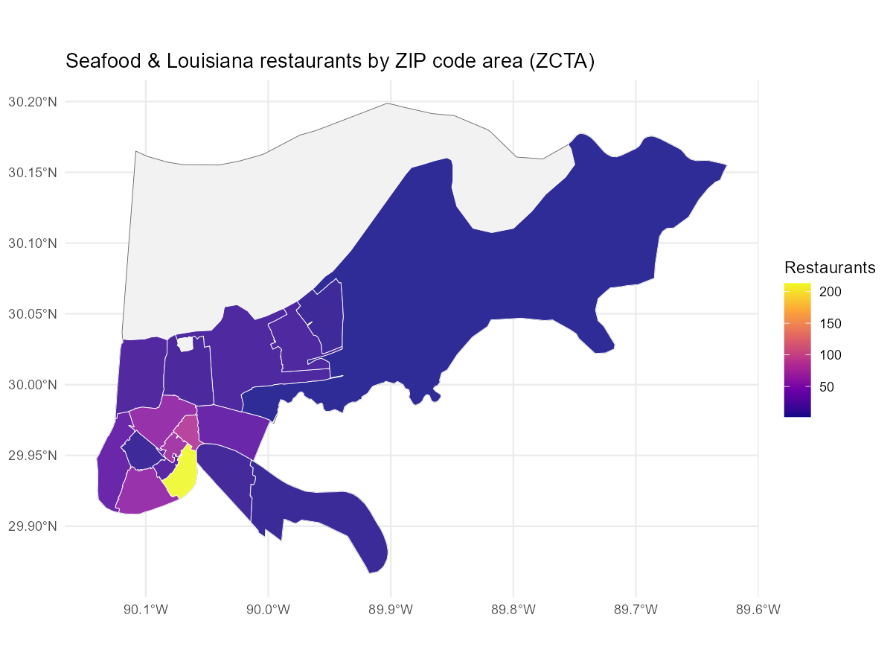
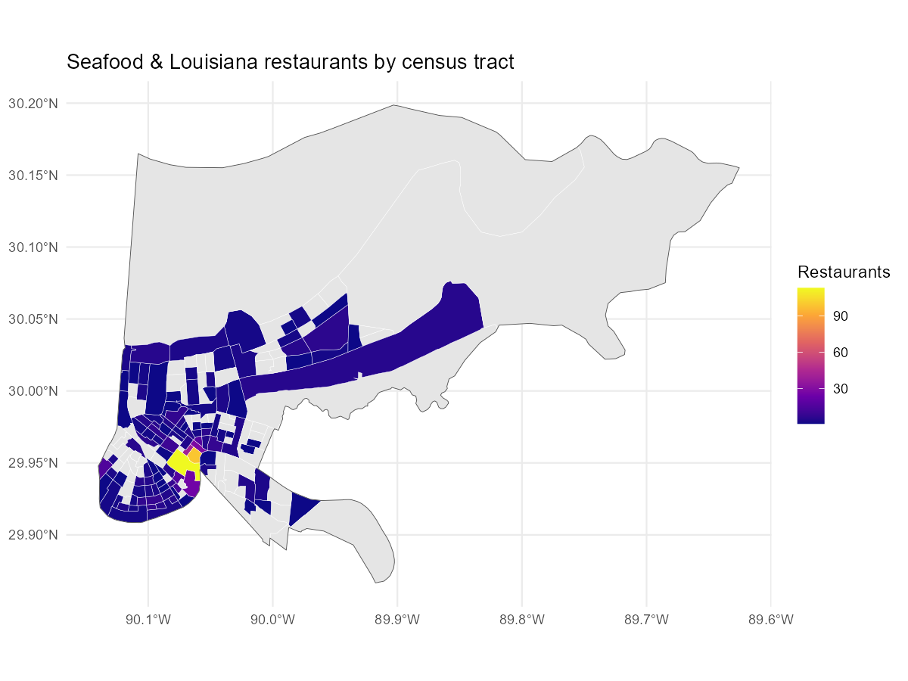
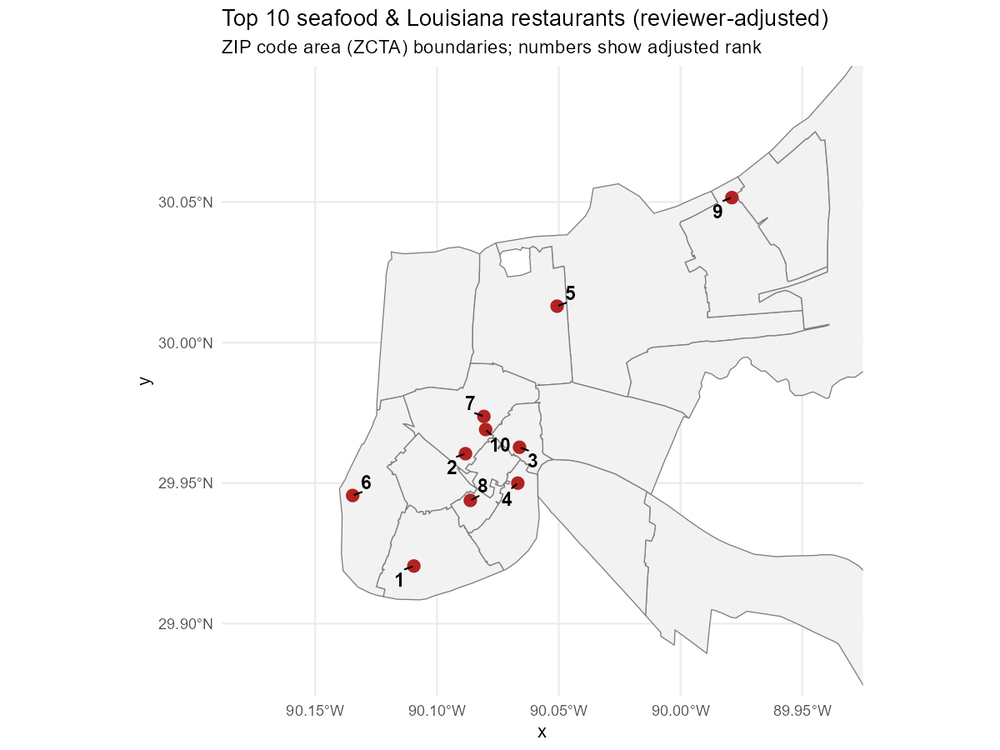
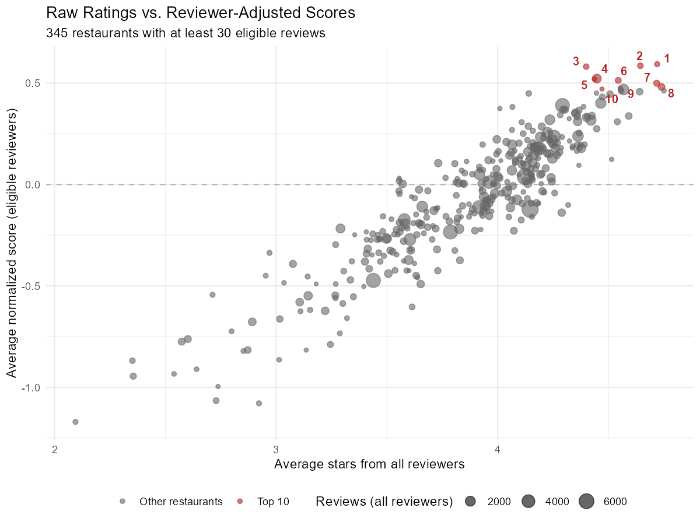

```{r}
library(tidyverse)
library(sf)
library(tigris)
library(ggrepel)
options(tigris_use_cache = TRUE)
dir.create("figures", showWarnings = FALSE)
```

## Research question and area choice

**Question:** Where in New Orleans can someone find the best seafood and
Louisiana-style restaurants, and which geographic area is best for comparing
them?

**Area I am picking: ZIP code areas (ZCTAs).** I compared ZCTAs with census
tracts. ZCTAs divide the 656 New Orleans restaurants into 17 areas, and 12 of
them have at least 10 restaurants and together hold 95.4% of the restaurants.
Census tracts divide the same restaurants into 111 areas, but only 10 have at
least 10 restaurants, and those hold just 57.3%. Half of the tracts (57 of 111)
have only one or two restaurants, so a tract's average rating would mostly
reflect one or two places. ZIP codes are also familiar to a general audience.

## Data

The filtered data come from the Yelp Open Dataset (see README for how it was
built with `R/import.R`).

```{r}
new_orleans_restaurants <- readRDS("data/new_orleans/business_new_orleans.rds")
reviews <- readRDS("data/new_orleans/reviews_new_orleans_no_text.rds")
nrow(new_orleans_restaurants)
nrow(reviews)
```

## Step 3: Category group

```{r}
restaurant_categories <- new_orleans_restaurants |>
  select(business_id, categories) |>
  separate_longer_delim(categories, delim = ",") |>
  mutate(category = str_to_lower(str_squish(categories))) |>
  select(business_id, category)

selected_categories <- c("seafood", "cajun/creole", "southern", "soul food")

cand <- restaurant_categories |> filter(category %in% selected_categories)

cand |> count(category, sort = TRUE)
n_distinct(cand$business_id)
```

**Why these categories belong together:** 
Seafood, Cajun/Creole, Southern, and Soul Food are all part of Louisiana
cooking, and they overlap in the data. The strongest link is between
Cajun/Creole and seafood: 156 restaurants carry both labels, which is 47% of
the 331 seafood restaurants. Cajun/Creole also overlaps with Southern (72
restaurants) and Soul Food (30). Of the 672 restaurants in the group, 231
(34%) carry two or more of the four categories, and 3 carry all four. Most
restaurants (441) carry only one of them, so the group is held together by a
shared cuisine theme with partial overlap, not by most restaurants carrying
several labels.

Pairs of categories that appear together on the same restaurant:

```{r}
cand |>
  inner_join(cand, by = "business_id", suffix = c("_a", "_b"),
             relationship = "many-to-many") |>
  filter(category_a < category_b) |>
  count(category_a, category_b, sort = TRUE)
```

**Inclusion rule:** a restaurant is included if it has at least one of the four
categories. I also considered "seafood markets" and "fish & chips," but together
they add only 3 restaurants not already in the group, so I left them out.

```{r}
selected_restaurants <- new_orleans_restaurants |>
  semi_join(cand, by = "business_id")
nrow(selected_restaurants)
```

## Step 4: Join reviews

```{r}
category_reviews <- reviews |>
  semi_join(selected_restaurants, by = "business_id") |>
  rename(review_stars = stars) |>
  left_join(
    selected_restaurants |>
      select(business_id, business_name, business_stars = stars),
    by = "business_id"
  )
nrow(category_reviews)
n_distinct(category_reviews$business_id)
```

## Step 5: Spatial join to the official New Orleans boundary

```{r}
louisiana_places <- tigris::places(state = "LA", cb = TRUE, year = 2024, class = "sf")

restaurant_points <- selected_restaurants |>
  st_as_sf(coords = c("longitude", "latitude"), crs = 4326, remove = FALSE) |>
  st_transform(st_crs(louisiana_places))

restaurants_with_place <- restaurant_points |>
  st_join(louisiana_places |> select(GEOID, place_name = NAME),
          join = st_within, left = TRUE)

restaurants_with_place |>
  st_drop_geometry() |>
  count(city, place_name, sort = TRUE)
```

Of the 672 selected restaurants, 656 fall inside the Census boundary for New
Orleans. The other 16 have a Yelp city of "New Orleans" but fall in
neighboring places: Harahan (4), Jefferson (4), Elmwood (2), and one each in
Arabi, Gretna, Harvey, Kenner, Metairie, and River Ridge. Most have street
addresses on roads such as Jefferson Highway, S Clearview Parkway, and
Westbank Expressway, which suggests Yelp's city label is broader than the
official boundary. Two have blank addresses, and one of them (Le Petit Bistro)
has a ZIP code (70115) that does not match its coordinates near Kenner, so its
location is unreliable. I excluded all 16 because the question is about New
Orleans.

```{r}
new_orleans_map_data <- restaurants_with_place |>
  filter(place_name == "New Orleans")
nrow(new_orleans_map_data)
```

## Step 6: Comparing geographic systems

```{r}
zctas <- tigris::zctas(cb = TRUE, starts_with = c("70", "71"), year = 2020) |>
  select(zcta = starts_with("ZCTA5CE"))

pts_zcta <- new_orleans_map_data |>
  st_transform(st_crs(zctas)) |>
  st_join(zctas, join = st_within, left = TRUE)

zcta_summary <- pts_zcta |>
  st_drop_geometry() |>
  filter(!is.na(zcta)) |>
  group_by(zcta) |>
  summarise(n_restaurants = n(),
            avg_business_stars = round(mean(stars), 2),
            .groups = "drop") |>
  arrange(desc(n_restaurants))

tracts <- tigris::tracts(state = "LA", county = "Orleans", cb = TRUE,
                         year = 2020, class = "sf") |>
  select(tract = GEOID)

pts_tract <- new_orleans_map_data |>
  st_transform(st_crs(tracts)) |>
  st_join(tracts, join = st_within, left = TRUE)

tract_summary <- pts_tract |>
  st_drop_geometry() |>
  filter(!is.na(tract)) |>
  group_by(tract) |>
  summarise(n_restaurants = n(),
            avg_business_stars = round(mean(stars), 2),
            .groups = "drop") |>
  arrange(desc(n_restaurants))
```

### Comparison table

```{r}
compare <- function(name, pts, id, summ) {
  tibble(
    `Geographic system` = name,
    `Areas with restaurants` = nrow(summ),
    `Restaurants assigned` = sum(summ$n_restaurants),
    `Unmatched` = sum(is.na(pts[[id]])),
    `Smallest count` = min(summ$n_restaurants),
    `Largest count` = max(summ$n_restaurants),
    `Areas with 10+` = sum(summ$n_restaurants >= 10),
    `Share of restaurants in areas with 10+` =
      round(sum(summ$n_restaurants[summ$n_restaurants >= 10]) /
              sum(summ$n_restaurants), 3)
  )
}

bind_rows(
  compare("ZIP/ZCTA", pts_zcta, "zcta", zcta_summary),
  compare("Census tract", pts_tract, "tract", tract_summary)
) |> knitr::kable()
```

### Restaurants and average rating by ZCTA

```{r}
knitr::kable(zcta_summary)
```

### Maps

```{r}
city_outline <- louisiana_places |> filter(NAME == "New Orleans")
zcta_map <- zctas |> inner_join(zcta_summary, by = "zcta")

p_zcta <- ggplot() +
  geom_sf(data = city_outline, fill = "grey95", color = "grey40") +
  geom_sf(data = zcta_map, aes(fill = n_restaurants), color = "white", alpha = 0.85) +
  scale_fill_viridis_c(option = "C", name = "Restaurants") +
  labs(title = "Seafood & Louisiana restaurants by ZIP code area (ZCTA)") +
  theme_minimal()
ggsave("figures/zcta_map.png", p_zcta, width = 8, height = 6, dpi = 150)

tract_map <- tracts |> left_join(tract_summary, by = "tract")

p_tract <- ggplot() +
  geom_sf(data = tract_map, aes(fill = n_restaurants), color = "white", linewidth = 0.1) +
  geom_sf(data = city_outline, fill = NA, color = "grey30") +
  scale_fill_viridis_c(option = "C", name = "Restaurants", na.value = "grey90") +
  labs(title = "Seafood & Louisiana restaurants by census tract") +
  theme_minimal()
ggsave("figures/tract_map.png", p_tract, width = 8, height = 6, dpi = 150)
```





## Why I chose ZCTAs

- **Enough restaurants to compare.** 12 of 17 ZCTAs have 10 or more
  restaurants and cover 95.4% of the sample. Only 10 of 111 tracts reach 10,
  covering 57.3%.
- **Tracts are too fine for ratings.** 57 tracts have only 1 or 2 restaurants,
  so ranking them by average rating would mostly rank individual restaurants.
- **Familiar areas.** ZIP codes are easy for a general reader to recognize.
- **What ZCTAs hide.** One ZCTA (70130) holds 213 restaurants, about a third
  of the sample, in a small area, so ZCTAs cannot distinguish among the
  restaurants inside the busiest dining district. Several ZCTAs have very few
  restaurants (70129 has only 2), so their average ratings are not reliable.
- **What tracts would show.** Tracts give finer detail but spread the
  restaurants too thin for reliable comparison.
  
## Step 7: All reviewers vs. reviewer-adjusted ratings 

This step uses the 656 restaurants inside the official New Orleans boundary. The
reviews are individual star ratings (`stars` in the review table, not the
restaurant's overall rating).

```{r}
study_ids <- new_orleans_map_data |> st_drop_geometry() |> pull(business_id)

study_reviews <- reviews |> filter(business_id %in% study_ids)

c(reviews = nrow(study_reviews),
  restaurants = n_distinct(study_reviews$business_id),
  reviewers = n_distinct(study_reviews$user_id))

all_reviewer_summary <- study_reviews |>
  group_by(business_id) |>
  summarise(number_of_reviews_all_reviewers = n(),
            average_stars_all_reviewers = mean(stars),
            median_stars_all_reviewers = median(stars),
            .groups = "drop")

summary(all_reviewer_summary$number_of_reviews_all_reviewers)
```

### Which reviewers are eligible?

A reviewer with one review in this group has a baseline equal to that single
rating, so their normalized score is always exactly 0 and carries no
information. I need a minimum activity level.

```{r}
reviewer_activity <- study_reviews |>
  count(user_id, name = "reviews_in_selected_categories")

map_dfr(c(1, 2, 3, 5, 10), function(k) {
  elig <- reviewer_activity |> filter(reviews_in_selected_categories >= k)
  tibble(
    min_reviews        = k,
    reviewers_kept     = nrow(elig),
    share_of_reviewers = round(nrow(elig) / nrow(reviewer_activity), 3),
    reviews_kept       = sum(elig$reviews_in_selected_categories),
    share_of_reviews   = round(sum(elig$reviews_in_selected_categories) /
                                 nrow(study_reviews), 3)
  )
}) |> knitr::kable()
```

I used a minimum of **5 reviews** per reviewer. That keeps 7,066 reviewers
(5.1% of reviewers) who wrote 59,584 reviews (23.9% of all reviews). A higher
cutoff gives each reviewer a more trustworthy baseline but discards most of
the data: at 10 reviews only 1.0% of reviewers and 10.1% of reviews remain. A
lower cutoff keeps more reviews but with weaker baselines: at 2 reviews, 62.7%
of reviews remain, but each baseline rests on very little.

### Normalizing each reviewer's scores

Each reviewer's baseline is their mean rating across the selected restaurants.
The normalized score is the rating minus that baseline, so it measures whether
a reviewer rated a restaurant higher or lower than they usually do. It is not
a new Yelp rating.

I used the **mean** baseline instead of the median because star ratings are
whole numbers, so a reviewer's median can take only five values and hides the
difference between, for example, a reviewer who averages 3.6 and one who
averages 4.4 (both can have a median of 4).

```{r}
adjust_reviews <- function(min_reviews = 5) {
  baselines <- study_reviews |>
    group_by(user_id) |>
    summarise(reviewer_mean = mean(stars),
              reviewer_median = median(stars),
              reviewer_review_count = n(),
              .groups = "drop")

  study_reviews |>
    left_join(baselines, by = "user_id") |>
    filter(reviewer_review_count >= min_reviews) |>
    mutate(normalized_mean_score = stars - reviewer_mean,
           normalized_median_score = stars - reviewer_median)
}

eligible_adjusted_reviews <- adjust_reviews(5)

nrow(eligible_adjusted_reviews)
# each reviewer's scores average to 0 by construction, so this should be ~0
mean(eligible_adjusted_reviews$normalized_mean_score)
```

### Restaurant-level comparison

```{r}
restaurant_summary <- all_reviewer_summary |>
  left_join(
    eligible_adjusted_reviews |>
      group_by(business_id) |>
      summarise(number_of_reviews_eligible_reviewers = n(),
                average_stars_eligible_reviewers = mean(stars),
                average_normalized_score = mean(normalized_mean_score),
                median_normalized_score = median(normalized_mean_score),
                .groups = "drop"),
    by = "business_id") |>
  left_join(new_orleans_map_data |> st_drop_geometry() |>
              select(business_id, business_name), by = "business_id")

sum(is.na(restaurant_summary$number_of_reviews_eligible_reviewers))

map_dfr(c(5, 10, 20, 30), function(k)
  tibble(min_eligible_reviews = k,
         restaurants_kept = sum(restaurant_summary$number_of_reviews_eligible_reviewers >= k,
                                na.rm = TRUE))) |> knitr::kable()
```

Nine restaurants have no eligible reviews at all and drop out of the adjusted
analysis. Among the rest, the number of eligible reviews per restaurant varies
a lot (median 36, but a quarter have 9 or fewer), so I need a minimum number
of eligible reviews before ranking a restaurant.

### How sensitive is the top 10 to that minimum?

```{r}
top10_ids <- function(k) {
  restaurant_summary |>
    filter(number_of_reviews_eligible_reviewers >= k) |>
    slice_max(average_normalized_score, n = 10, with_ties = FALSE) |>
    pull(business_id)
}

cutoffs <- c(5, 10, 20, 30)
tops <- map(cutoffs, top10_ids)
overlap <- outer(seq_along(cutoffs), seq_along(cutoffs),
                 Vectorize(function(i, j) length(intersect(tops[[i]], tops[[j]]))))
dimnames(overlap) <- list(paste("min", cutoffs), paste("min", cutoffs))
knitr::kable(overlap, caption = "Restaurants shared by the top-10 lists at each minimum")
```

The top 10 depends heavily on the minimum. Compared with the list at a minimum
of 20 eligible reviews, the lists at 5, 10, and 30 share 0, 4, and 7
restaurants. At a minimum of 5, every restaurant in the top 10 had only 6 to 16
eligible reviews, so a few generous ratings were enough to put it on top. The
three restaurants that drop out between 20 and 30 had only 20, 21, and 24
eligible reviews. I chose **30** because it removes the thinnest evidence,
and I picked it from this sensitivity check and not by looking for a particular
list. The cost is that only 345 of 656 restaurants (52.6%) can be ranked.

```{r}
min_n <- 30

ranked <- restaurant_summary |>
  filter(number_of_reviews_eligible_reviewers >= min_n) |>
  mutate(rank_raw      = rank(-average_stars_all_reviewers, ties.method = "min"),
         rank_adjusted = rank(-average_normalized_score,    ties.method = "min"),
         rank_change   = rank_raw - rank_adjusted) |>
  arrange(rank_adjusted)

nrow(ranked)
```

## Answer: the top 10 restaurants

```{r}
top10 <- ranked |> slice_head(n = 10) |>
  select(business_id, business_name, rank_adjusted)

top10_pts <- new_orleans_map_data |>
  select(business_id) |>
  inner_join(top10, by = "business_id") |>
  st_transform(st_crs(zctas))

top10_table <- top10_pts |>
  st_join(zctas, join = st_within) |>
  st_drop_geometry() |>
  left_join(ranked |> select(business_id, number_of_reviews_eligible_reviewers,
                             average_stars_all_reviewers, average_normalized_score),
            by = "business_id") |>
  arrange(rank_adjusted) |>
  select(Rank = rank_adjusted, Restaurant = business_name, ZCTA = zcta,
         `Eligible reviews` = number_of_reviews_eligible_reviewers,
         `Avg stars (all reviewers)` = average_stars_all_reviewers,
         `Adjusted score` = average_normalized_score)

knitr::kable(top10_table, digits = 2)
```

```{r}
xy <- st_coordinates(top10_pts)
top10_labels <- st_drop_geometry(top10_pts) |> mutate(x = xy[, 1], y = xy[, 2])

city_zctas <- zctas |> filter(zcta %in% zcta_summary$zcta)
bb <- st_bbox(st_buffer(st_union(top10_pts), 4000))

p_top10 <- ggplot() +
  geom_sf(data = city_zctas, fill = "grey95", color = "grey50", linewidth = 0.3) +
  geom_sf(data = top10_pts, color = "firebrick", size = 3) +
  geom_text_repel(data = top10_labels, aes(x = x, y = y, label = rank_adjusted),
                  size = 4, fontface = "bold", min.segment.length = 0) +
  coord_sf(xlim = c(bb["xmin"], bb["xmax"]), ylim = c(bb["ymin"], bb["ymax"])) +
  labs(title = "Top 10 seafood & Louisiana restaurants (reviewer-adjusted)",
       subtitle = "ZIP code area (ZCTA) boundaries; numbers show adjusted rank") +
  theme_minimal()
ggsave("figures/top10_map.png", p_top10, width = 8, height = 6, dpi = 150)
```



The ten restaurants fall in eight different ZCTAs. ZCTA 70119 has the most
(3), and the other seven have one each. ZCTA 70130, which holds 213 of the
656 restaurants (32%), has only one of the top ten. These scores are close
together (ranks 8 to 10 differ by about 0.01), so I treat the list as a group
and not a strict order.

## Raw ratings vs. reviewer-adjusted scores

```{r}
plot_data <- ranked |>
  mutate(group = if_else(rank_adjusted <= 10, "Top 10", "Other restaurants"))

p_scatter <- ggplot(plot_data,
       aes(x = average_stars_all_reviewers, y = average_normalized_score)) +
  geom_hline(yintercept = 0, color = "grey70", linetype = "dashed") +
  geom_point(aes(size = number_of_reviews_all_reviewers, color = group), alpha = 0.6) +
  scale_color_manual(values = c("Other restaurants" = "grey40", "Top 10" = "firebrick"),
                     name = NULL) +
  geom_text_repel(data = filter(plot_data, group == "Top 10"),
                  aes(label = rank_adjusted), size = 3.5, fontface = "bold",
                  color = "firebrick") +
  labs(title = "Raw Ratings vs. Reviewer-Adjusted Scores",
       subtitle = "345 restaurants with at least 30 eligible reviews",
       x = "Average stars from all reviewers",
       y = "Average normalized score (eligible reviewers)",
       size = "Reviews (all reviewers)") +
  theme_minimal() +
  theme(legend.position = "bottom")
ggsave("figures/scatter_raw_vs_adjusted.png", p_scatter, width = 8, height = 6, dpi = 150)
```



The raw average and the adjusted score are strongly correlated
(r = `r round(cor(ranked$average_stars_all_reviewers, ranked$average_normalized_score), 2)`),
so the adjustment mostly preserves the overall ordering. Part of that is built
in, because both measures come from the same star ratings. Restaurants with
similar raw averages can still differ by several tenths of a point in adjusted
score, which is why rankings in the middle of the list change a lot even though
the top stays similar.

## Which restaurants change rank the most? 

```{r}
baseline_by_restaurant <- eligible_adjusted_reviews |>
  group_by(business_id) |>
  summarise(avg_reviewer_baseline = mean(reviewer_mean), .groups = "drop")

ranked |>
  left_join(baseline_by_restaurant, by = "business_id") |>
  arrange(desc(abs(rank_change))) |>
  slice_head(n = 10) |>
  mutate(eligible_minus_all = average_stars_eligible_reviewers - average_stars_all_reviewers) |>
  select(business_name, number_of_reviews_eligible_reviewers, avg_reviewer_baseline,
         average_stars_all_reviewers, average_normalized_score,
         eligible_minus_all, rank_raw, rank_adjusted, rank_change) |>
  knitr::kable(digits = 2)
```

Every restaurant in this list has at least 37 eligible reviews, so small samples are a weaker explanation here than for the lower cutoffs. Several movers fit a reviewer-behavior explanation. Gallier Restaurant & Oyster Bar, Marjie's Grill, and Corporation Bar & Grill fell 129 to 193 places and are rated by fairly generous reviewers (average baselines of 4.04, 4.12, and 4.06) who also rated them below their own usual scores. Mat & Naddie's, Rio Mar, and New Orleans Hamburger & Seafood Co. rose 122 to 146 places and are rated by tougher reviewers (baselines of 3.90, 3.83, and 3.86). A 4.3 from a generous reviewer says less than a 4.0 from a tough one. The other four large movers show a different  mechanism. Gautreau's and La Crepe Nanou rose 116 and 118 places, and Ruby Slipper Cafe (one of its two locations) and The Governor fell 117 and 119, but the average baseline of their reviewers is close to the same for all four (3.86 to 4.02). What differs is that the reviewers with at least five reviews rated the risers 0.18 to 0.20 stars higher than all reviewers did, and rated the fallers 0.28 to 0.30 stars lower. These moves therefore reflect disagreement between frequent reviewers and the general crowd as much as reviewer-level normalization. The rank changes also overstate how different the scores are, because many restaurants sit close to 0 and small score differences shift many ranks.

## Limitations

- **Enough restaurants to compare.** 12 of 17 ZCTAs have 10 or more
  restaurants and cover 95.4% of the sample. Only 10 of 111 tracts reach 10,
  covering 57.3%.
- **Tracts are too fine for ratings.** 57 tracts have only 1 or 2 restaurants,
  so ranking them by average rating would mostly rank individual restaurants.
- **Familiar areas.** ZIP codes are easy for a general reader to recognize.
- **What ZCTAs hide.** One ZCTA (70130) holds 213 restaurants, about a third
  of the sample, in a small area, so ZCTAs cannot distinguish among the
  restaurants inside the busiest dining district. Several ZCTAs have very few
  restaurants (70129 has only 2), so their average ratings are not reliable.
- **What tracts would show.** Tracts give finer detail but spread the
  restaurants too thin for reliable  